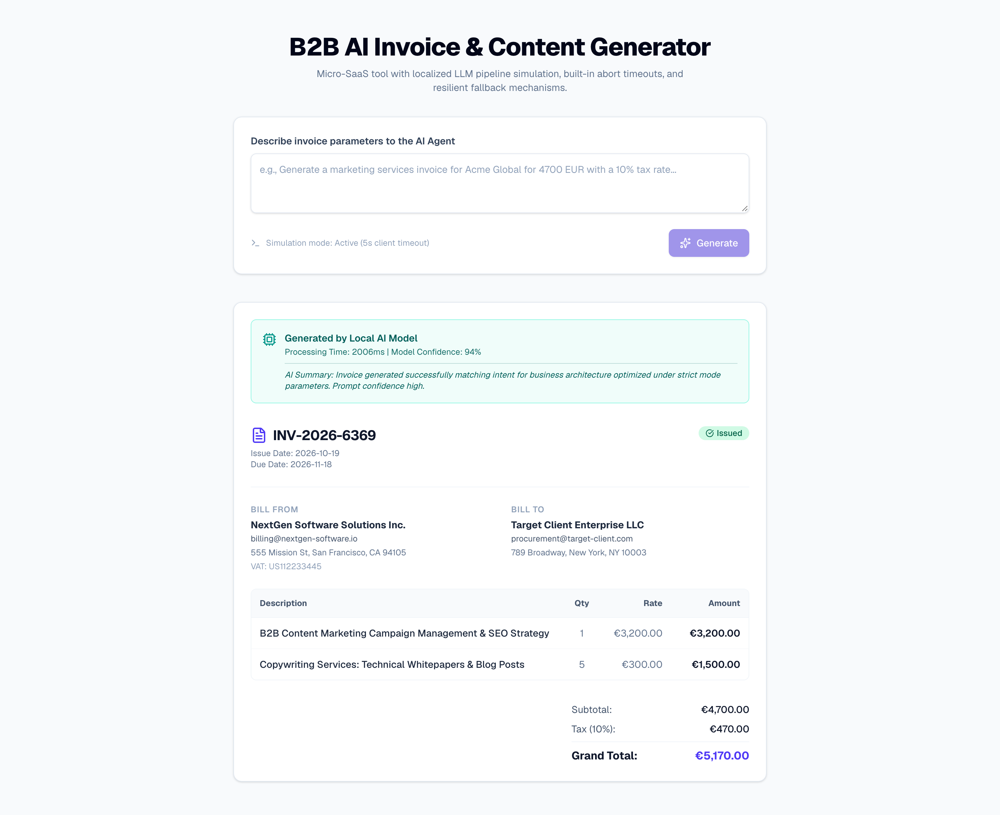

# AI Invoice Generator

A micro-SaaS tool that turns a plain-English prompt into a structured, previewable invoice. Built with **Next.js (App Router)**, **TypeScript**, and **Tailwind CSS**.

**Live demo:** [ai-invoice-generator-gray.vercel.app](https://ai-invoice-generator-gray.vercel.app)

> **Demo note:** the "AI" pipeline is simulated locally by a Next.js API route (no API key required). The route is designed to be replaced with a real LLM call.

## Screenshot



## Features

- **Prompt to invoice:** e.g. *"Generate a marketing services invoice for Acme Global for 4700 EUR with a 10% tax rate."* Currency, line items, and tax are inferred from the prompt.
- **Resilient request flow:** `AbortController` with a 5-second client timeout; on timeout or failure a fallback invoice is loaded and the UI explains why.
- **Cancellable server work:** the API route respects the request's `AbortSignal`.
- **Polished UX:** skeleton loader, status badges, tax and totals calculation, responsive layout.
- **Feature-based structure:** UI, hooks, and API logic are separated for maintainability.

## Tech Stack

Next.js · React · TypeScript · Tailwind CSS · Lucide icons

## Project Structure

```text
src/
├── app/
│   ├── api/invoice/route.ts   # Simulated LLM pipeline (validation, parsing, totals, fallback)
│   └── page.tsx               # Prompt form and results
└── features/invoice-generator/
    ├── components/            # InvoicePreview, InvoiceSkeleton
    └── hooks/useInvoiceSubmit.ts   # Fetch logic, timeout, error handling
```

## Getting Started

```bash
git clone https://github.com/SeriDaron/ai-invoice-generator.git
cd ai-invoice-generator
npm install
npm run dev
```

Open [http://localhost:3000](http://localhost:3000).

## Extending It

- Swap the simulation in `route.ts` for an OpenAI/Anthropic call with structured (JSON) output.
- Add PDF export, saved invoices, and client management.

## Need something similar?

I build AI-powered business tools and SaaS MVPs. Feel free to reach out.
